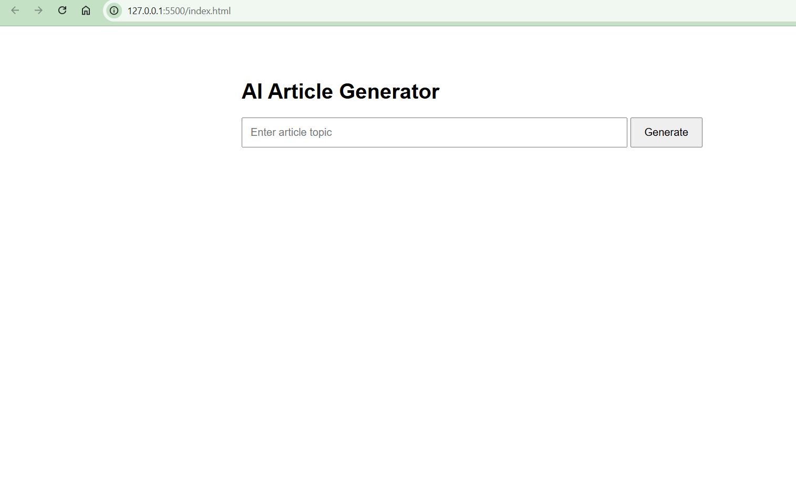

# AI Article Generator

An AI-powered article generation project built using HTML, CSS, JavaScript, n8n, and Groq AI.

Users can enter a topic on the website, which is sent to an n8n workflow through a webhook. The workflow uses an AI Agent powered by the Groq Chat Model to generate an article and return the result to the website.

## Features

- Simple and user-friendly interface
- Simple and easy to use 
- Made by using n8n workflow 
- Topic-based article generation
- Webhook integration with n8n
- AI-powered content generation using Groq
- Automated response handling

## Tech Stack

- HTML5
- CSS3
- JavaScript
- n8n (Workflow Automation)
- Groq AI (Llama 3.3 70B Versatile)

## How It Works

1. User enters an article topic.
2. JavaScript sends the topic to an n8n webhook.
3. The AI Agent receives the topic.
4. Groq Chat Model generates the article.
5. The generated article is returned to the website through the webhook response.

## Workflow Architecture

```text
User enters a topic
        |
        v
Frontend (HTML, CSS, JavaScript)
        |
        v
n8n Webhook
        |
        v
AI Agent
        |
        v
Groq Chat Model
        |
        v
Respond to Webhook
        |
        v
Generated Article
```

## Project Structure

```text
AI-Article-Generator/
│
├── index.html
├── README.md
├── .gitignore
│
└── workflow/
    └── QgWjEbGCGrwIXIfH-My_workflow.json
```

## Setup Instructions

### 1. Clone the Repository

```bash
git clone https://github.com/12srishti34/AI-Article-Generator.git
```

### 2. Open the Project

Open the project folder and run `index.html` in your browser.

### 3. Configure n8n

- Import the workflow JSON file into an n8n instance.
- Configure your Groq API credentials.
- Activate the workflow.
- Copy the production webhook URL.

### 4. Connect the Frontend

Update the webhook URL in `index.html` with your own active n8n webhook URL.

### 5. Generate an Article

Enter a topic and click the Generate button.

**Note:** Article generation requires an active n8n workflow and valid Groq API credentials. The original cloud webhook used during development may no longer be active.

## Screenshots

### 📸 Project Preview



## Author

**Srishti Chadha**

GitHub: [12srishti34](https://github.com/12srishti34)

